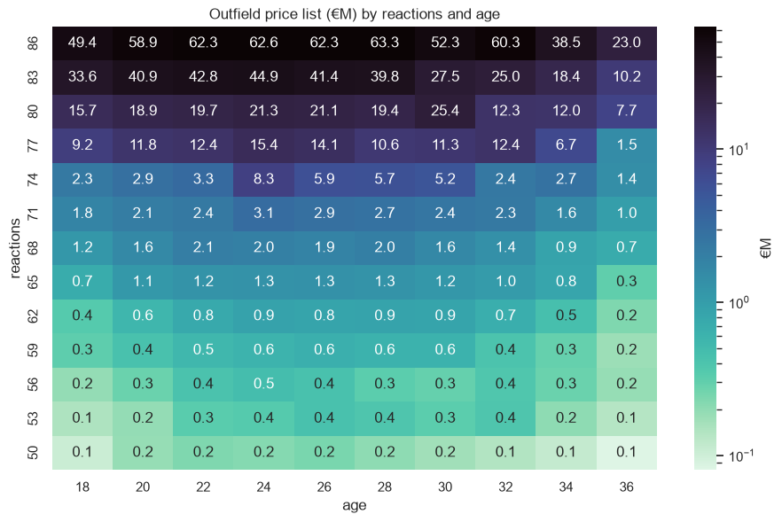
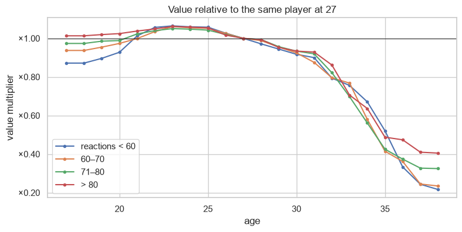
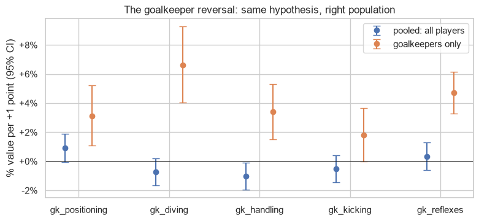
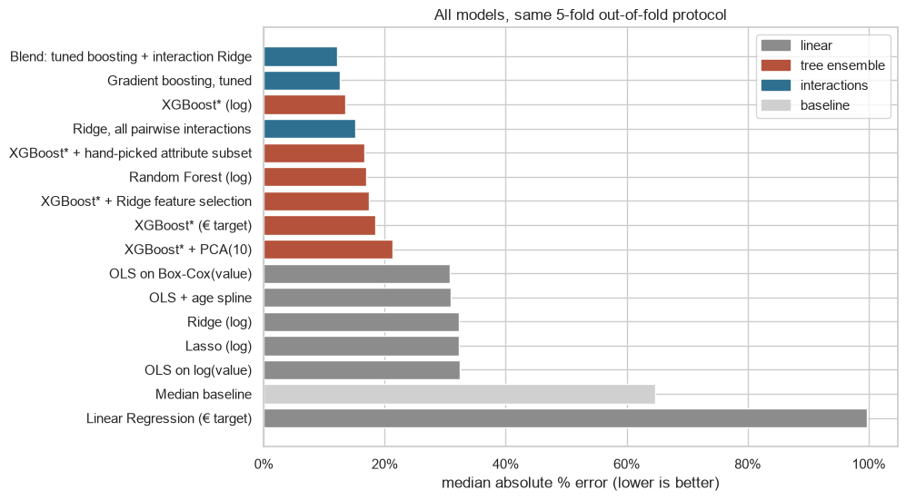
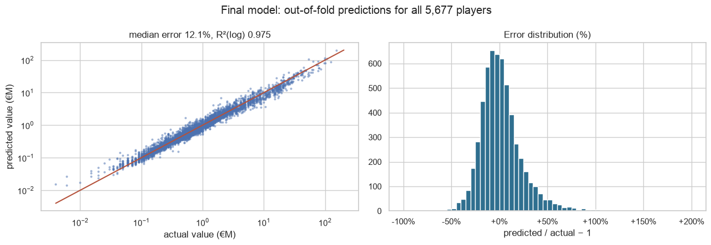

# What Makes a FIFA 24 Player Worth €150 Million?

**Statistical analysis and value prediction for 5,677 FIFA 24 players: which attributes the game's valuation pays for, how age changes the price, and which players are priced below their attributes.**

| Median pricing error | Players priced within ±25% | R² (log value) | Models compared |
|:---:|:---:|:---:|:---:|
| **12.1%** | **81%** | **0.975** | **16** |

All scores are cross-validated: each player is predicted by a model that never saw them.

---

## Highlights

### 1. Club and nationality add nothing to the prediction
Once you know a player's attributes and age, knowing that he plays for Real Madrid or Rochdale doesn't change the predicted price. Adding club or nationality to the model gives **zero** improvement. FIFA 24 value is a formula on the player card, and this project reverse-engineers it.

### 2. Value is exponential: +5 points of ability doubles the price
Each point of `reactions`, the best proxy for a card's hidden overall rating, multiplies value by about 1.14. Going from 80 to 85 is worth tens of millions; going from 60 to 65 is worth a few hundred thousand.

<p align="center"></p>

### 3. Value falls steeply after 30
Take any player, keep every attribute fixed, and change only his age. Value peaks at **23–25**, holds until about 29, then drops sharply: the same player is worth **half as much at 34** as at 27.

<p align="center"></p>

### 4. Each position is paid for different attributes
The dataset has no position column, so seven playing roles are **discovered by clustering** attribute profiles. The clusters check out against known players (Mbappé and Haaland as strikers, Van Dijk at centre-back, Rodri as defensive mid). Testing each role on its own players changes **11 of 20 conclusions** compared with a model pooled over everyone. Goalkeepers show the clearest flip: their GK attributes look irrelevant when pooled, but drive their price when analysed separately.

<p align="center"></p>

### 5. A built-in scout: who plays like a star but costs less?
Players are matched on playing *style* (attribute profile with overall level removed), then ranked by price:

| Plays like **Kevin De Bruyne** (€107.5M) | Style match | Cost |
|---|:---:|:---:|
| Mason Mount | 0.94 | 39% |
| Jonas Hofmann | 0.91 | 24% |
| Bruno Fernandes | 0.90 | 67% |

The same tool lists Mitrović and Dembélé as Haaland-style strikers at about 15% of his price. A **bargain finder** flags players priced below their calibrated 80% value range.

---

## How the model was built

<p align="center"></p>

- **Careful cleaning:**
  - The raw values use a format that is easy to misread: `$975.00` means **€975,000**, and parsing it naively makes 59% of players 10× too cheap.
  - The file mixes UTF-8 and Latin-1 text encoding.
  - Club names carry trailing spaces, which hide duplicate rows.
- **Log-value target:** prices span €4k to €153.5M, so errors are measured as percentages.
- **One fair protocol for every model:** 5-fold cross-validation, with all preprocessing done inside the folds. Models compared:
  - linear: OLS, log and Box-Cox targets, Ridge, Lasso
  - tree ensembles: Random Forest; XGBoost, also with feature selection or PCA
  - interaction models and a blend
- **The winner:** a blend of gradient boosting and a Ridge regression with all pairwise interactions. Boosting can't predict above the highest prices it has seen, and the Ridge corrects for that at the top end.
- **Honest uncertainty:** conformal prediction intervals, re-calibrated per age band, so that an "80% range" really contains 80% of players.
- **Rigorous inference:** robust (HC3) standard errors, Benjamini–Hochberg multiple-testing control, and joint tests for collinear attributes.
- **Explainability:** SHAP shows what drives each prediction, e.g. why Mbappé is worth €153.5M.

<p align="center"></p>

---

## Explore

| | |
|---|---|
| 📓 [**FIFA24_ANALYSIS.ipynb**](FIFA24_ANALYSIS.ipynb) | The full analysis in one notebook: cleaning → EDA → roles → models → hypothesis tests → value drivers → intervals and scouting |
| 📄 [**Regression Project report.pdf**](Regression%20Project%20report.pdf) | The written report |
| 🧪 [**notebooks/**](notebooks/) | The same analysis in seven steps (`00_data_cleaning` … `06_intervals_and_scouting`), each focused on one question |
| 📊 `player_stats.csv` | Source data: [FIFA 24 Player Stats Dataset](https://www.kaggle.com/datasets/rehandl23/fifa-24-player-stats-dataset) (Kaggle) |

### Run it

```bash
python -m venv .venv && source .venv/bin/activate
pip install -r requirements.txt
jupyter lab FIFA24_ANALYSIS.ipynb
```

The full notebook runs in about 7 minutes on a laptop. To use real XGBoost, `pip install xgboost` (on macOS also `brew install libomp`). Otherwise scikit-learn's equivalent is used, marked `XGBoost*`.

---

**Scope:** the results explain how FIFA 24 *prices* a player card, not real-world transfer fees, which also depend on contracts, form and the market.

**Author:** Ram Sampreeth Budireddy
